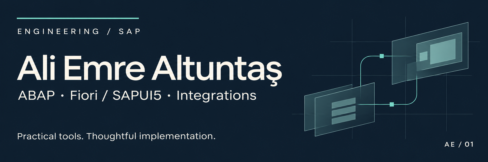
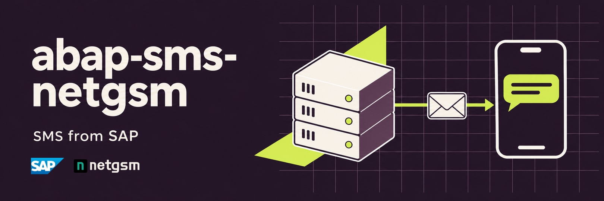

[Türkçe](README.md) · [Portfolio](https://aliemrealtuntas.com/en/) · [LinkedIn](https://www.linkedin.com/in/ali-emre-altuntas/)

## SAP ABAP & Fiori/UI5 Developer

I’m a computer engineer based in Ankara. I build finance and data quality applications in ABAP and design Fiori/UI5 screens for people working in the field. My work has included posting payments in SAP FI and tracking products from a handheld terminal.

## Inside a project · SMS from SAP

I built this report so a team can prepare a text message in SAP when a document is ready. Before sending, the user can preview which phone numbers are valid and how many SMS segments the message will use.

[See the SAP screens](https://aliemrealtuntas.com/projects/netgsm/) · [Source code and setup](https://github.com/Cheditte/abap-sms-netgsm)

## More open-source projects

- **Central bank exchange rates.** Compare the daily TCMB rate with the value in SAP and see what will be added or changed before saving. [Screens](https://aliemrealtuntas.com/projects/rates/) · [Code](https://github.com/Cheditte/abap-tcmb-rates)
- **Incoming email.** Bring messages and attachments into SAP. The team can open a document or retry a message that failed to process. [Screens](https://aliemrealtuntas.com/projects/imap/) · [Code](https://github.com/Cheditte/abap-imap-inbound)
- **Duplicate business partners.** Find similar customer and vendor records and see which details match. The reviewer makes the final call. [Screens](https://aliemrealtuntas.com/projects/partners/) · [Code](https://github.com/Cheditte/abap-partner-duplicates)

## Private projects in pictures

- [Approve an SAP request in Slack](https://aliemrealtuntas.com/projects/slack/) — Follow the approval from the Slack message back to the request in SAP.
- [Turn an SAP request into a Jira issue](https://aliemrealtuntas.com/projects/jira/) — See where the request starts in SAP and the issue the team receives in Jira.
- [View a Microsoft 365 calendar in SAP](https://aliemrealtuntas.com/projects/graph/) — See how calendar entries read through Microsoft Graph appear in SAP.

[All SAP integrations](https://aliemrealtuntas.com/en/#transfer-yard) · [My experience](https://aliemrealtuntas.com/about/)
