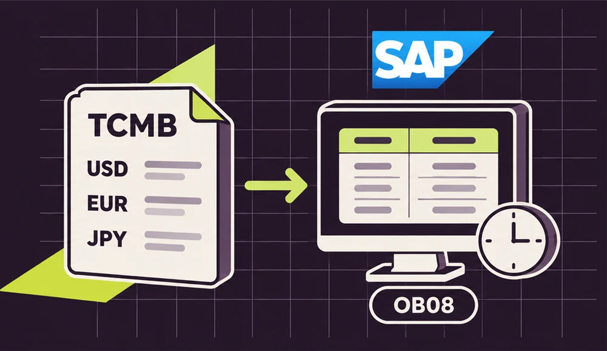
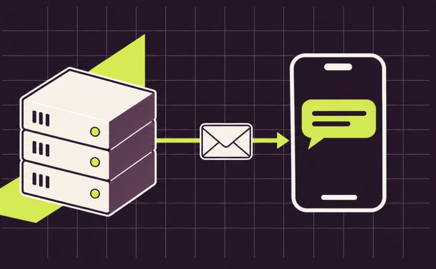
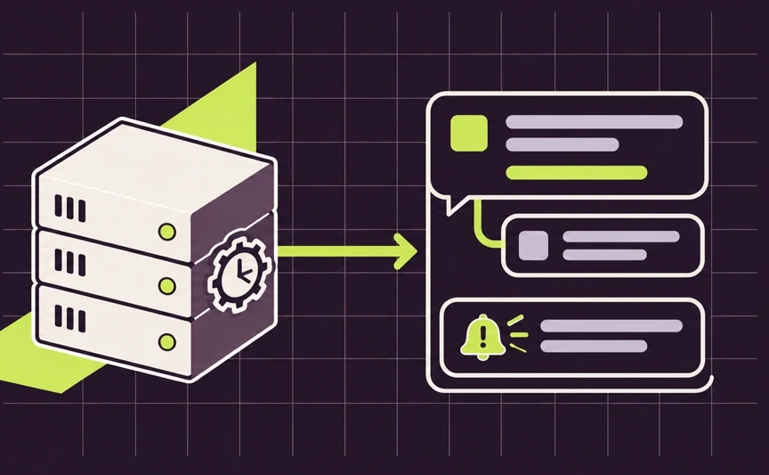
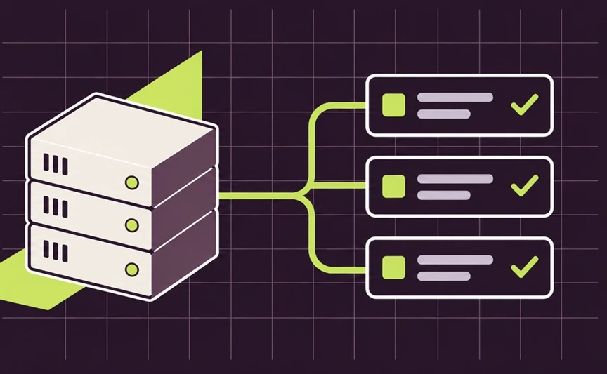
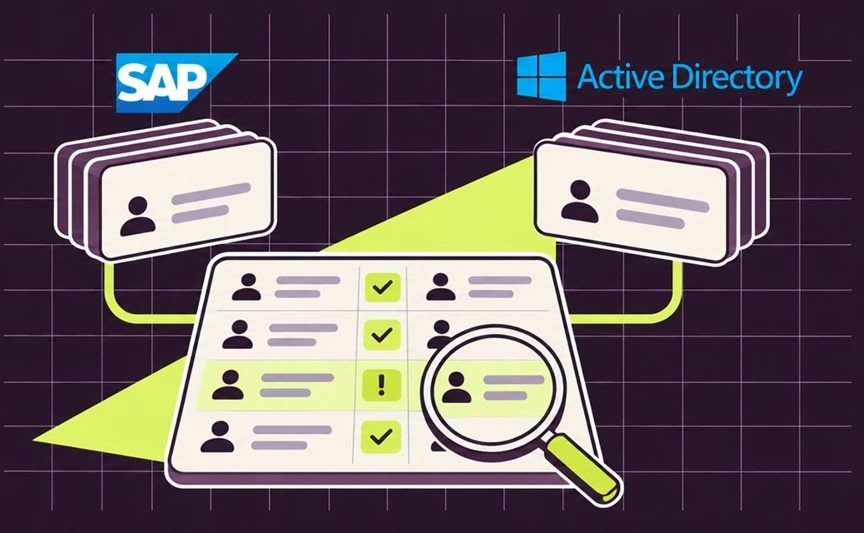

[Türkçe](README.md) · [Portfolio](https://aliemrealtuntas.com/en/) · [LinkedIn](https://www.linkedin.com/in/ali-emre-altuntas/)

# SAP ABAP & Fiori/UI5 Developer

My work ranges from posting payments in SAP FI for finance teams to building handheld product-tracking screens for people in the field. Here are the tools I’ve built and the ways I connect SAP to the applications teams use every day.

## Open-source projects

<table>
<tr>
  <td width="50%" valign="top">
    
    
<strong>Central bank exchange rates</strong>

    
Compare the daily TCMB rate with the value in SAP. Review new and changed rates before saving.

    <a href="https://aliemrealtuntas.com/projects/rates/">View screens</a> · <a href="https://github.com/Cheditte/abap-tcmb-rates">Source code</a>
  </td>
  <td width="50%" valign="top">
    
    
<strong>SMS from SAP</strong>

    
Prepare a text message when a document is ready. Check valid recipients and the number of SMS segments before sending.

    <a href="https://aliemrealtuntas.com/projects/netgsm/">View screens</a> · <a href="https://github.com/Cheditte/abap-sms-netgsm">Source code</a>
  </td>
</tr>
<tr>
  <td width="50%" valign="top">
    
    
<strong>An inbox for SAP</strong>

    
Read incoming email and its attachments in SAP. Open the document or retry a message that failed, from the same screen.

    <a href="https://aliemrealtuntas.com/projects/imap/">View screens</a> · <a href="https://github.com/Cheditte/abap-imap-inbound">Source code</a>
  </td>
  <td width="50%" valign="top">
    
    
<strong>Business partner matching</strong>

    
See which details match across two customer or vendor records. A reviewer decides whether they belong to the same person or company.

    <a href="https://aliemrealtuntas.com/projects/partners/">View screens</a> · <a href="https://github.com/Cheditte/abap-partner-duplicates">Source code</a>
  </td>
</tr>
</table>

## SAP integrations

Explore the six stops on the [interactive portfolio map](https://aliemrealtuntas.com/en/#transfer-yard), or select an illustration to see that project’s screens.

<table>
<tr>
  <td width="50%" valign="top">
    
    
<strong><a href="https://aliemrealtuntas.com/projects/slack/">Slack</a></strong>

    
Approve or reject an SAP request from a Slack message. The decision is recorded against the request in SAP.

  </td>
  <td width="50%" valign="top">
    
    
<strong><a href="https://aliemrealtuntas.com/projects/jira/">Jira</a></strong>

    
A request raised in SAP becomes a Jira issue that the team can follow in its own workspace.

  </td>
</tr>
<tr>
  <td width="50%" valign="top">
    
    
<strong><a href="https://aliemrealtuntas.com/projects/whatsapp/">WhatsApp</a></strong>

    
A PDF prepared in SAP appears as a document in WhatsApp. The recipient’s reply returns to SAP.

  </td>
  <td width="50%" valign="top">
    
    
<strong><a href="https://aliemrealtuntas.com/projects/graph/">Microsoft 365 · Graph</a></strong>

    
Microsoft 365 calendar entries appear in SAP, so a user can read meeting details where they work.

  </td>
</tr>
<tr>
  <td width="50%" valign="top">
    
    
<strong><a href="https://aliemrealtuntas.com/projects/directory/">Active Directory</a></strong>

    
Compare account status across the two systems and find accounts still enabled in SAP after being disabled in the directory.

  </td>
  <td width="50%" valign="top">
    
    
<strong><a href="https://aliemrealtuntas.com/projects/ldap/">LDAP</a></strong>

    
An employee signs in to the portal with a company account. SAP checks the account status and password against the directory so the portal can grant or deny access.

  </td>
</tr>
</table>

[My experience](https://aliemrealtuntas.com/about/) · [Get in touch](https://aliemrealtuntas.com/contact/)
