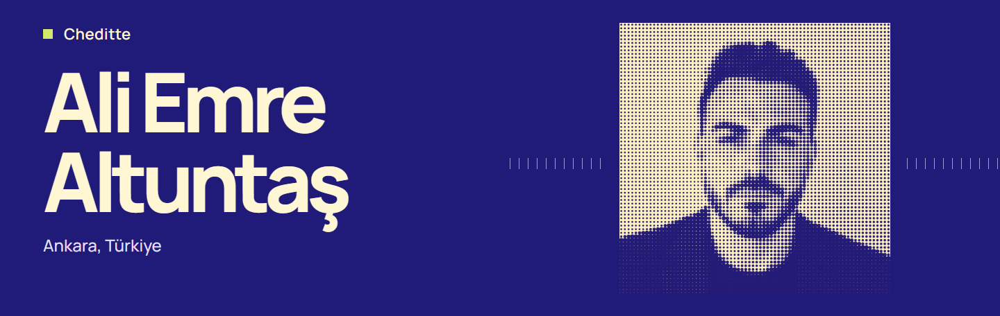
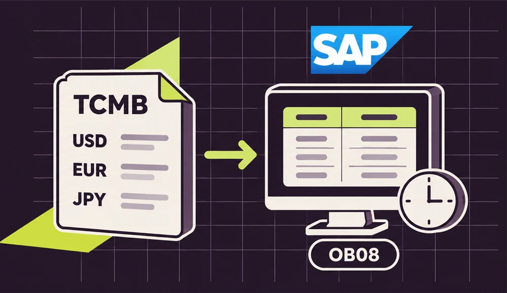
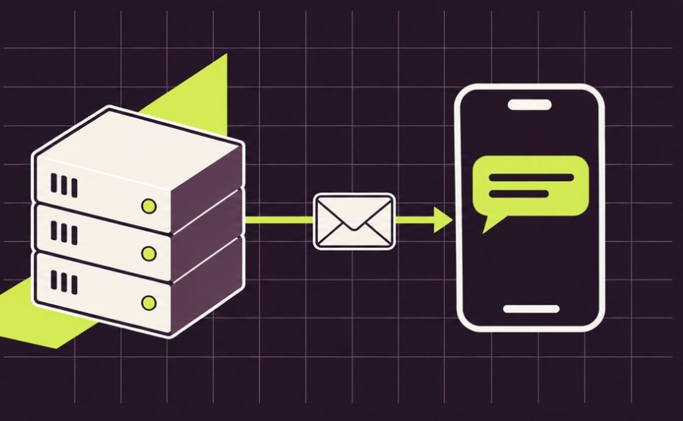
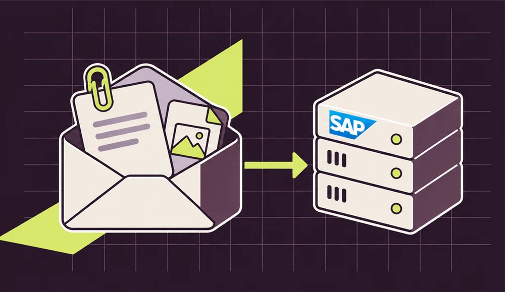
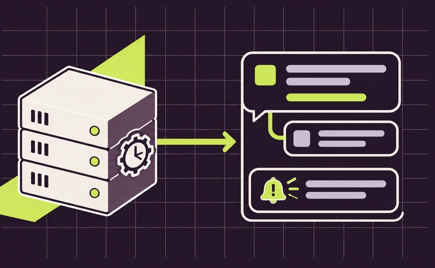
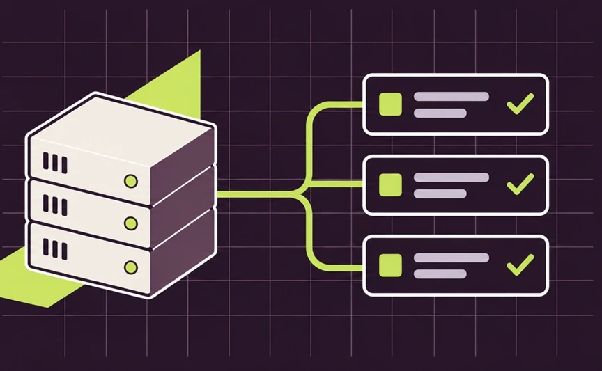
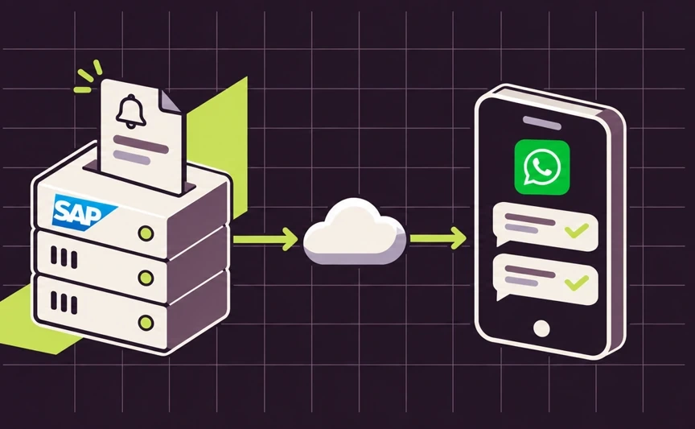
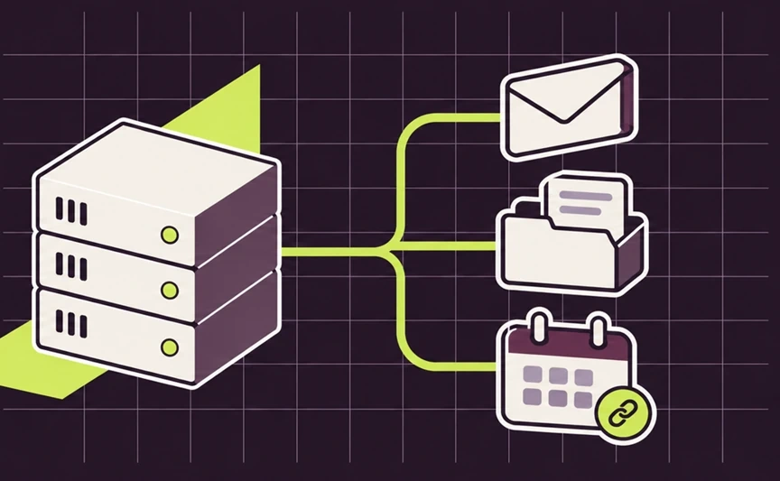
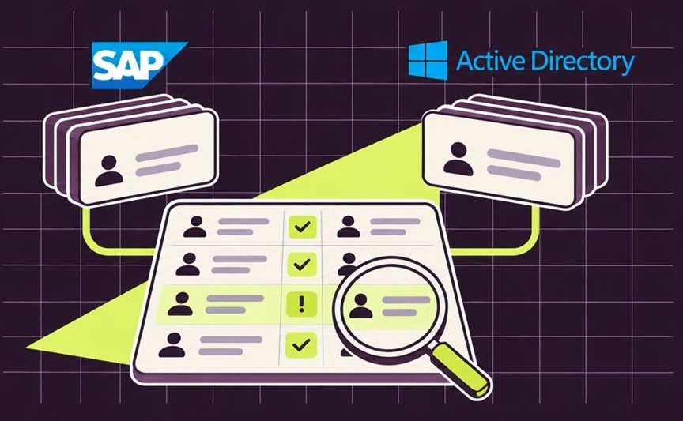
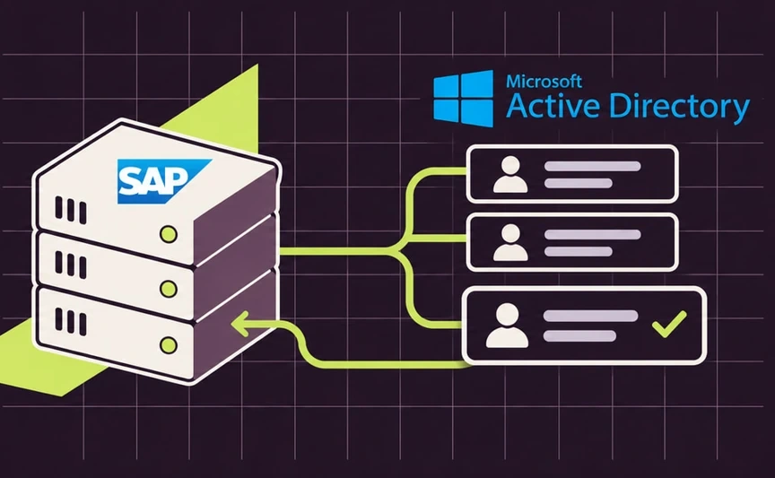

[English](README.en.md) · [Portföy](https://aliemrealtuntas.com/) · [LinkedIn](https://www.linkedin.com/in/ali-emre-altuntas/)

# SAP ABAP & Fiori/UI5 Geliştiricisi

Finans ekipleri için tahsilatların SAP FI’da muhasebeleştirilmesi, sahadaki ekipler için de ürünlerin el terminalinden takibi üzerine çalıştım. Burada geliştirdiğim araçları ve SAP’yi ekiplerin kullandığı uygulamalarla nasıl buluşturduğumu paylaşıyorum.

## Açık kaynak projeler

<table>
<tr>
  <td width="50%" valign="top">
    
    
<strong>TCMB döviz kurları</strong>

    
Günün kurunu SAP’deki değerle karşılaştırır. Kullanıcı eklenen ve değişen kurları kontrol edip kaydeder.

    <a href="https://aliemrealtuntas.com/tr/projeler/rates/">Ekranları incele</a> · <a href="https://github.com/Cheditte/abap-tcmb-rates">Kaynak kodu</a>
  </td>
  <td width="50%" valign="top">
    
    
<strong>SAP’den SMS</strong>

    
Ekip, belge hazır olduğunda SAP’de bir SMS hazırlar. Göndermeden önce geçerli alıcıları ve mesajın kaç parçaya bölündüğünü görür.

    <a href="https://aliemrealtuntas.com/tr/projeler/netgsm/">Ekranları incele</a> · <a href="https://github.com/Cheditte/abap-sms-netgsm">Kaynak kodu</a>
  </td>
</tr>
<tr>
  <td width="50%" valign="top">
    
    
<strong>SAP gelen kutusu</strong>

    
Gelen e-postayı ekleriyle birlikte SAP’ye alır. Ekip belgeyi açabilir ve işlenemeyen postayı aynı ekrandan yeniden deneyebilir.

    <a href="https://aliemrealtuntas.com/tr/projeler/imap/">Ekranları incele</a> · <a href="https://github.com/Cheditte/abap-imap-inbound">Kaynak kodu</a>
  </td>
  <td width="50%" valign="top">
    
    
<strong>İş ortağı eşleştirme</strong>

    
İki müşteri veya tedarikçi kaydında hangi bilgilerin eşleştiğini gösterir. Kayıtların aynı kişiye ya da kuruluşa ait olup olmadığına ekip karar verir.

    <a href="https://aliemrealtuntas.com/tr/projeler/partners/">Ekranları incele</a> · <a href="https://github.com/Cheditte/abap-partner-duplicates">Kaynak kodu</a>
  </td>
</tr>
</table>

## SAP entegrasyonları

Altı projeyi [portföydeki haritada gez](https://aliemrealtuntas.com/#transfer-yard) veya bir görsele dokunarak doğrudan o projenin ekranlarına geç.

<table>
<tr>
  <td width="50%" valign="top">
    
    
<strong><a href="https://aliemrealtuntas.com/tr/projeler/slack/">Slack</a></strong>

    
Ekip, SAP talebini Slack mesajından onaylar veya reddeder. Verilen karar SAP’deki talebe geri yazılır.

  </td>
  <td width="50%" valign="top">
    
    
<strong><a href="https://aliemrealtuntas.com/tr/projeler/jira/">Jira</a></strong>

    
SAP’de açılan talep Jira’da bir iş kaydına dönüşür. Ekip işi kendi Jira ekranından takip eder.

  </td>
</tr>
<tr>
  <td width="50%" valign="top">
    
    
<strong><a href="https://aliemrealtuntas.com/tr/projeler/whatsapp/">WhatsApp</a></strong>

    
SAP’de hazırlanan PDF telefonda WhatsApp belgesi olarak görünür. Alıcının yanıtı SAP’ye döner.

  </td>
  <td width="50%" valign="top">
    
    
<strong><a href="https://aliemrealtuntas.com/tr/projeler/graph/">Microsoft 365 · Graph</a></strong>

    
Microsoft 365 takvimindeki toplantılar SAP ekranında listelenir. Kullanıcı toplantı bilgisini çalıştığı yerden okuyabilir.

  </td>
</tr>
<tr>
  <td width="50%" valign="top">
    
    
<strong><a href="https://aliemrealtuntas.com/tr/projeler/directory/">Active Directory</a></strong>

    
Dizinde devre dışı bırakıldığı hâlde SAP’de açık kalan hesapları karşılaştırma raporunda gösterir.

  </td>
  <td width="50%" valign="top">
    
    
<strong><a href="https://aliemrealtuntas.com/tr/projeler/ldap/">LDAP</a></strong>

    
Çalışan şirket hesabıyla portala girer. SAP, hesabın etkinliğini ve parolayı dizinde doğrular. Portal bu sonuca göre oturumu açar veya girişi reddeder.

  </td>
</tr>
</table>

[Deneyimim](https://aliemrealtuntas.com/hakkimda/) · [İletişim](https://aliemrealtuntas.com/iletisim/)
