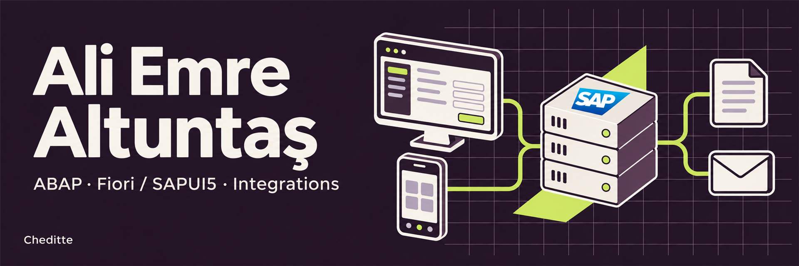
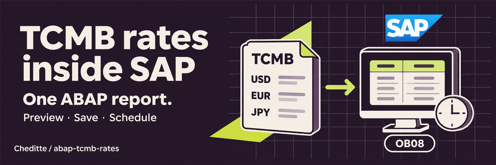

  <a href="https://www.linkedin.com/in/ali-emre-altuntas/">LinkedIn</a> &nbsp; / &nbsp;
  <a href="https://www.aliemrealtuntas.com">Portfolio</a> &nbsp; / &nbsp;
  <a href="README.tr.md">Türkçe</a>

I'm **Ali Emre Altuntaş**, a computer engineer and SAP developer based in Ankara, Türkiye. I build business applications and integrations with **ABAP and Fiori/SAPUI5**, connecting user interfaces, SAP services, and backend processes.

Here, I share practical tools and implementation experience, with an emphasis on clear setup, maintainable code, and everyday use.

## Open-source SAP tools

### TCMB exchange rates for SAP

Read daily exchange rates from the Central Bank of the Republic of Türkiye, preview the results, and save rates to SAP for verification in **OB08**. Install through **SE38 with one source file**, use Turkish or English screens, and schedule recurring execution.

**[Explore the project](https://github.com/Cheditte/abap-tcmb-rates)** &nbsp; / &nbsp; [Setup & usage](https://github.com/Cheditte/abap-tcmb-rates/blob/main/WALKTHROUGH.md) &nbsp; / &nbsp; [Türkçe rehber](https://github.com/Cheditte/abap-tcmb-rates/blob/main/WALKTHROUGH.tr.md)

| What you need | Project |
|---|---|
| Email, files, calendars and Teams workflows with Microsoft 365 | [abap-graph](https://github.com/Cheditte/abap-graph) |
| Read and process emails and attachments from an IMAP mailbox in SAP | [abap-imap-inbound](https://github.com/Cheditte/abap-imap-inbound) |
| Review potential duplicate customer and vendor records | [abap-partner-duplicates](https://github.com/Cheditte/abap-partner-duplicates) |

Each repository explains its setup, examples and verified scope.

<strong>More code: React frontend example</strong>

A small React blog application in [dojo-blog](https://github.com/Cheditte/dojo-blog), exploring components, routing, and frontend structure.

## Expertise

| SAP development | User experience | Systems integration |
| :--- | :--- | :--- |
| ABAP · ABAP Objects · SAP ERP | Fiori · SAPUI5 · JavaScript | OData · REST APIs · RFC · BAPI |
| Business logic, validation and error handling | Business applications and handheld interfaces | Data exchange between SAP and external platforms |

## Experience in practice

- **Finance and documents:** online collection integration with SAP FI, automated accounting, and e-invoice processing.
- **Operational applications:** Fiori/SAPUI5 handheld interfaces and product traceability, with data validation and consistency checks.
- **Connected workflows:** SAP PS / Microsoft Project integration, mobile signatures, and electronic signatures.

Client code, business data, and internal system details remain private. Public work includes only shareable examples and implementation patterns.

## How I work

I start with the business requirement and consider the user journey, data quality, integration behavior, and failure cases together. I value readable code, practical documentation, code review, and validation against real business scenarios.

---

**Let's connect:** [LinkedIn](https://www.linkedin.com/in/ali-emre-altuntas/) · [Portfolio](https://www.aliemrealtuntas.com)
