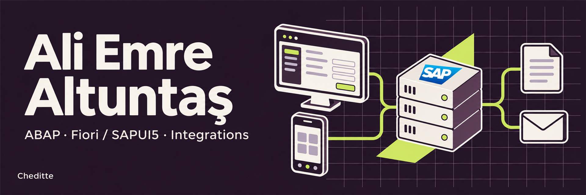
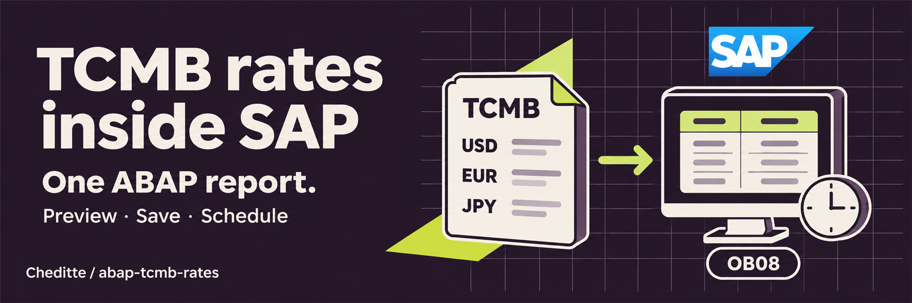

  <a href="https://www.linkedin.com/in/ali-emre-altuntas/">LinkedIn</a> &nbsp; / &nbsp;
  <a href="https://www.aliemrealtuntas.com">Portföy</a> &nbsp; / &nbsp;
  <a href="README.md">English</a>

Ben **Ali Emre Altuntaş**. Ankara'da yaşayan bir bilgisayar mühendisi ve SAP geliştiricisiyim. **ABAP ve Fiori/SAPUI5** ile iş uygulamaları ve entegrasyonlar geliştiriyor; kullanıcı arayüzlerini, SAP servislerini ve arka plan süreçlerini bir araya getiriyorum.

Burada kurulumu anlaşılır, bakımı kolay ve günlük kullanımda fayda sağlayan araçlarımı ve geliştirme deneyimlerimi paylaşıyorum.

## Açık kaynak SAP araçları

### SAP için TCMB döviz kurları

Türkiye Cumhuriyet Merkez Bankası'nın günlük kurlarını okuyun, sonuçları ön izleyin ve SAP'ye kaydederek **OB08'de** kontrol edin. **SE38 üzerinden tek kaynak dosyasıyla** kurun; Türkçe veya İngilizce ekranları kullanın ve düzenli çalışması için arka plan işi planlayın.

**[Projeyi incele](https://github.com/Cheditte/abap-tcmb-rates)** &nbsp; / &nbsp; [Kurulum ve kullanım](https://github.com/Cheditte/abap-tcmb-rates/blob/main/WALKTHROUGH.tr.md) &nbsp; / &nbsp; [English guide](https://github.com/Cheditte/abap-tcmb-rates/blob/main/WALKTHROUGH.md)

| İhtiyaç | Proje |
|---|---|
| Microsoft 365 ile e-posta, dosya, takvim ve Teams işlemleri | [abap-graph](https://github.com/Cheditte/abap-graph) |
| IMAP kutusundaki e-postaları ve ekleri SAP'de okumak ve işlemek | [abap-imap-inbound](https://github.com/Cheditte/abap-imap-inbound) |
| Olası mükerrer müşteri ve satıcı kayıtlarını incelemek | [abap-partner-duplicates](https://github.com/Cheditte/abap-partner-duplicates) |

Her projenin kurulum adımları, örnekleri ve doğrulanmış kapsamı kendi deposunda açıklanıyor.

<strong>Diğer kod çalışması: React arayüz örneği</strong>

[dojo-blog](https://github.com/Cheditte/dojo-blog), bileşenler, sayfa yönlendirmeleri ve arayüz yapısı üzerine küçük bir React blog uygulamasıdır.

## Uzmanlık alanları

| SAP geliştirme | Kullanıcı deneyimi | Sistem entegrasyonu |
| :--- | :--- | :--- |
| ABAP · ABAP Objects · SAP ERP | Fiori · SAPUI5 · JavaScript | OData · REST API · RFC · BAPI |
| İş mantığı, veri doğrulama ve hata yönetimi | İş uygulamaları ve el terminali arayüzleri | SAP ile dış platformlar arasında veri alışverişi |

## Projelerdeki deneyimim

- **Finans ve belgeler:** SAP FI ile çevrim içi tahsilat entegrasyonu, otomatik muhasebeleştirme ve e-fatura işleme.
- **Operasyonel uygulamalar:** veri doğrulama ve tutarlılık kontrolleriyle Fiori/SAPUI5 el terminali arayüzleri ve ürün takibi.
- **Bağlantılı süreçler:** SAP PS / Microsoft Project entegrasyonu, mobil imza ve elektronik imza çözümleri.

Müşteri kodları, iş verileri ve kurum içi sistem bilgileri gizli tutulur. Herkese açık çalışmalar yalnız paylaşılabilir örnekler ve uygulama yaklaşımları içerir.

## Geliştirme yaklaşımım

İş ihtiyacından başlayarak kullanıcı akışını, veri kalitesini, entegrasyon davranışını ve hata durumlarını birlikte ele alırım. Okunabilir kodu, uygulanabilir dokümantasyonu, kod incelemesini ve gerçek iş senaryolarıyla doğrulamayı önemserim.

---

**İletişim:** [LinkedIn](https://www.linkedin.com/in/ali-emre-altuntas/) · [Portföy](https://www.aliemrealtuntas.com)
